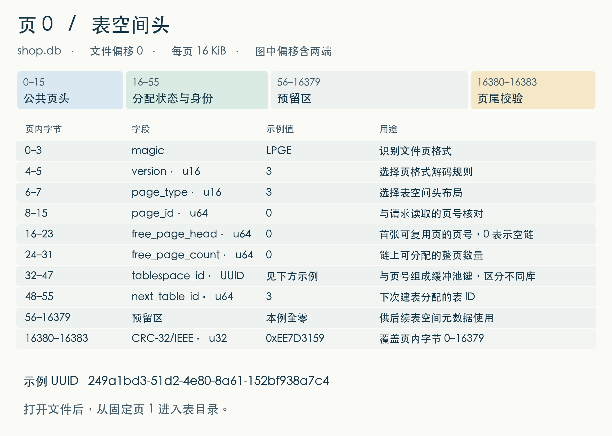
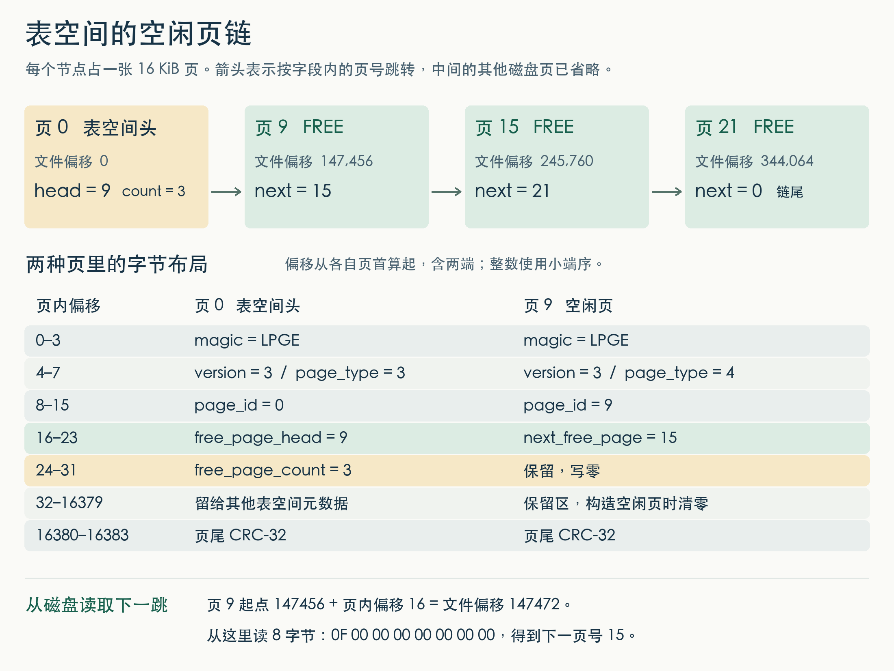
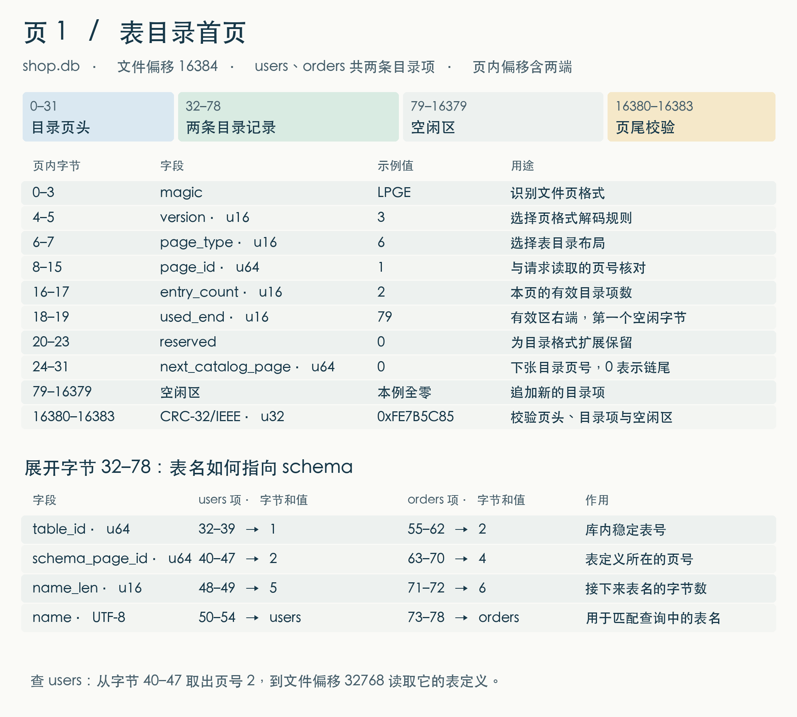
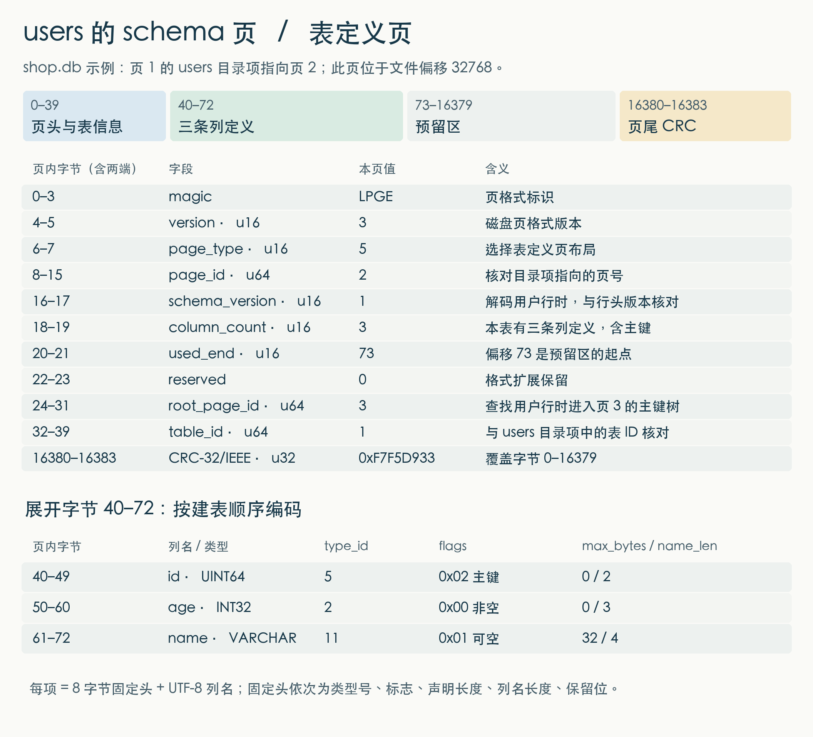
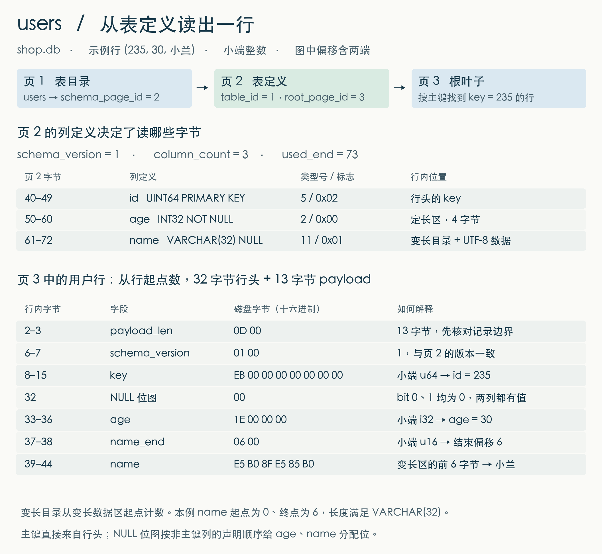
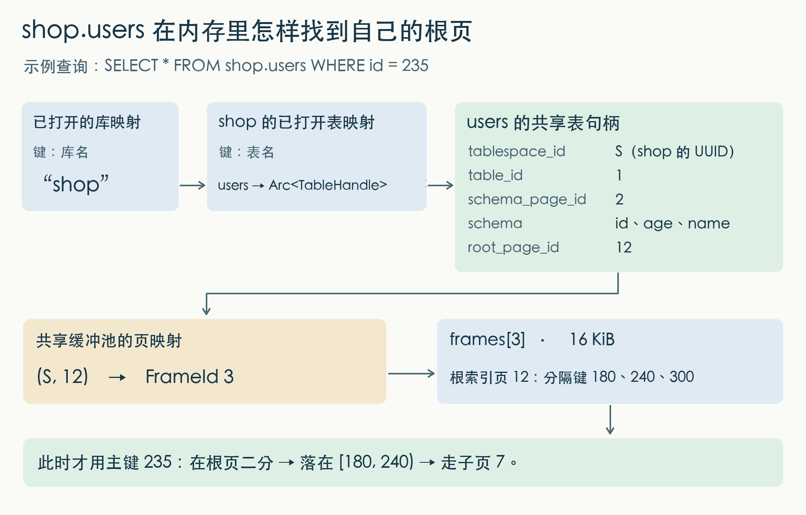
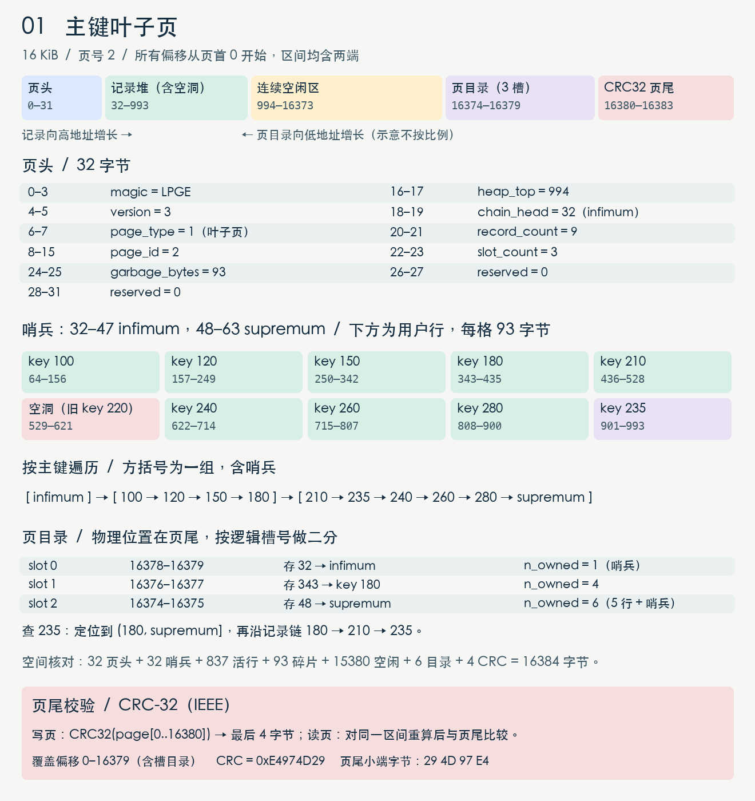
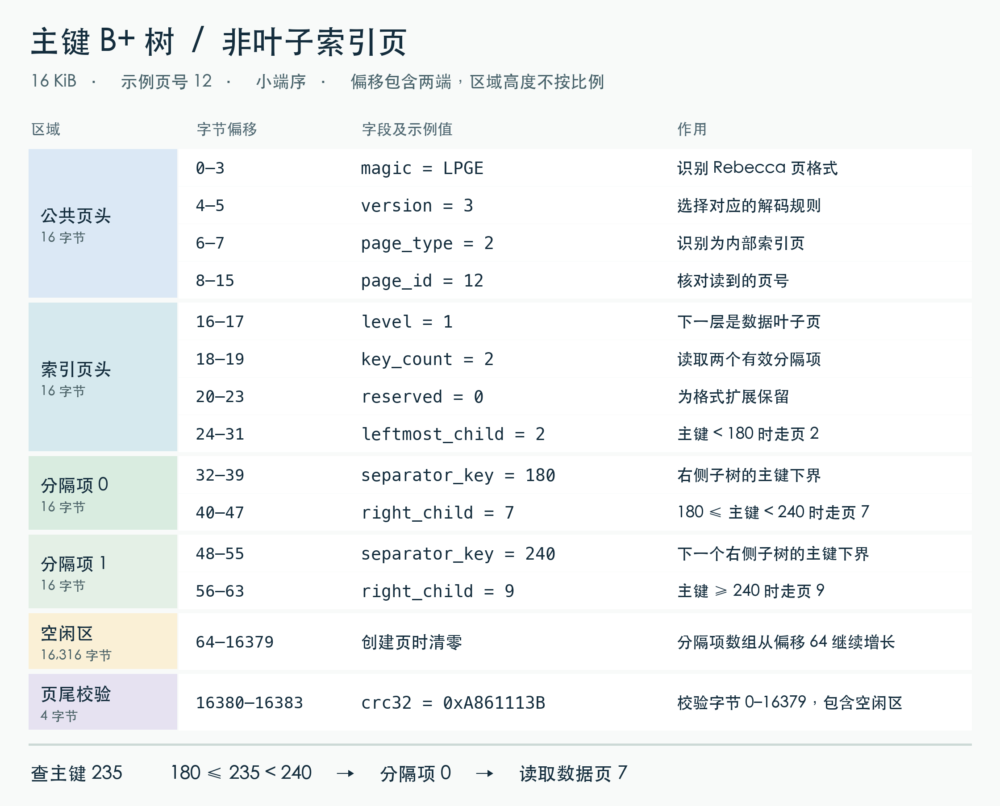
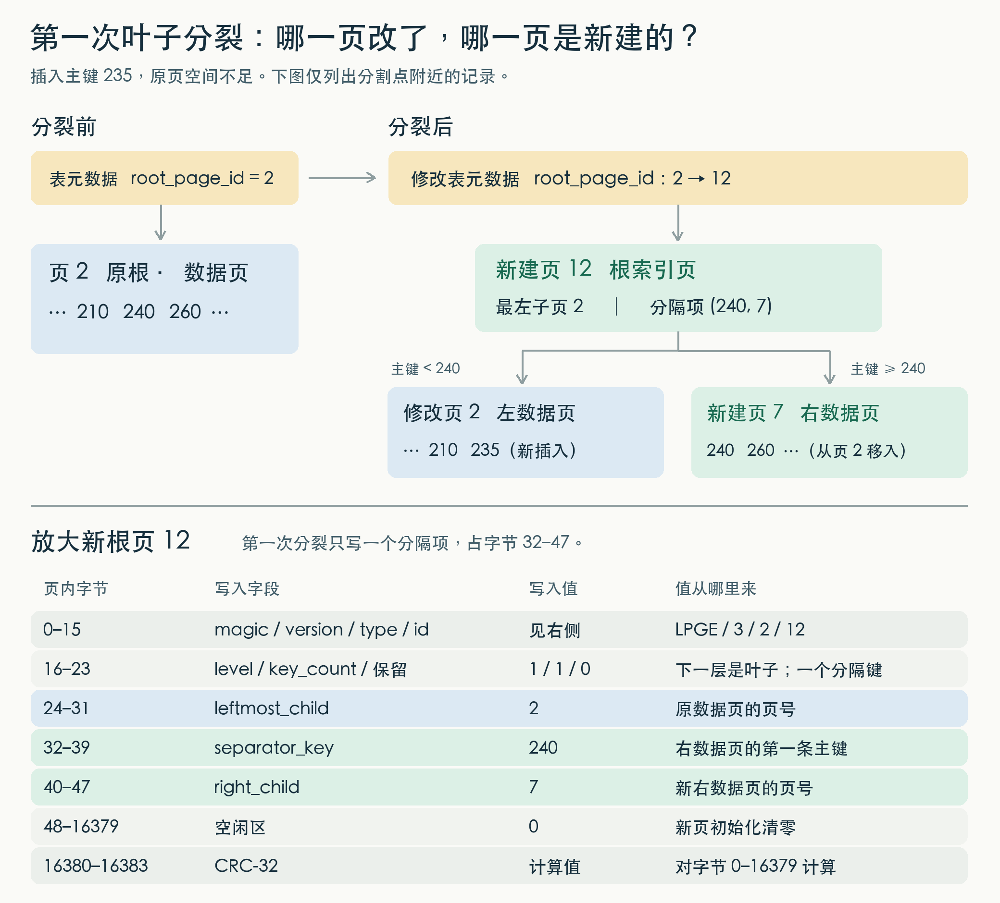
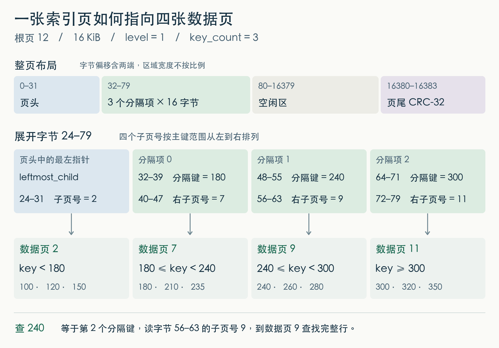

# Rebecca 存储引擎设计

## 1. 范围、状态与阅读顺序

Rebecca 是实验性的 Rust 存储引擎。第一阶段的交付目标是对单张主键叶子页完成编解码、按键增删查、遍历、整理及完整读写。后续把这些页组成一棵树，再通过表目录打开一张表。下表记录截至 2026-11-25 的讨论状态；文中的验收场景是实现目标。

| 范围 | 讨论状态 | 实现时依据 |
|---|---|---|
| 页与行 | 当前基线 | 16 KiB 页，小端序，页尾 CRC；u64 聚簇键、有序行链、分组槽、32 字节用户行头；MVCC 位和字段写零。字节布局采用页格式版本 3。 |
| 内存缓冲池 | 设计提案 | 固定帧数组、按页键查找、空闲帧栈、可淘汰帧 LRU；同步换出与关闭流程见 §6.1。 |
| 库、表空间、分配器 | 已确认的 v1 范围 | 一库一文件，多张表共享一个表空间；页 0 管理空闲页；页 1 是表目录入口；从链头分配，空链时追加页。 |
| 多页主键树 | 当前草案 | 定长分隔项、相等走右侧、原根叶分裂时另建根。并发分裂与故障恢复待设计。 |
| 表目录、表定义 | 字段布局待评审 | 现有字节图采用每表独占一页；共享 schema 页需另定目录项和槽格式。表空间 UUID、表号分配字段见 §2.2。 |
| 隐藏键、字符串主键、事务和查询 | 后续提案 | 分清物理键与用户声明的主键；区间锁、MVCC、redo/undo、跨库 JOIN 各有独立的实现依赖。 |
| SQL 入口 | 已选定解析库与分工 | 使用 Rust 的 `sqlparser` 将 SQL 转成 AST，由 Rebecca 完成绑定和计划，再调用存储引擎接口执行。 |
| 分布式复制 | 单机稳定后的议题 | 待明确复制内容、确认提交和故障切换语义，再评估 Raft 或 Paxos。 |

**从文件找到一行。** 打开库文件 → 页 0 取得表空间身份 → 页 1 按表名找到表定义 → 取得列定义和当前根页号 → 逐层路由到叶子 → 按行头版本解码。缓冲池可以复用已读的页和目录，页号只在本表空间内有效。

| 要解决的问题 | 章节 |
|---|---|
| 怎样定位、分配、回收一张磁盘页？ | [§2 文件与表空间](#space) |
| 表名怎样找到 schema？小表能否共用定义页？ | [§3 目录与表定义](#catalog) |
| 一行怎样编码、查找、删除和整理？ | [§4 数据页与行](#leaf) |
| 主键树怎样导航、增长和移除子页？ | [§5 主键 B+ 树](#tree) |
| 谁持锁、谁刷脏页，故障后如何界定状态？ | [§6 缓冲池与事务](#txn) |
| 实现时验证哪些边界？哪些决定还要评审？ | [§7 验收](#verify) · [§8 待定事项](#open-issues) |
| 单机稳定后如何评估日志同步和共识？ | [§9 分布式复制](#replication) |
| SQL 怎样调用主键点查？ | [§3.6 SQL 与存储接口](#sql-entry) |

<a id="space"></a>

## 2. 文件、页类型与空间分配

整数和浮点字段都采用小端序。下文区间统一写为 **[起点, 终点)**，右端不包含，插图里的“起点～终点”则包含两端。叶子页中的行和槽使用相对页首的字节偏移，跨页引用使用表空间内的页号。读写时按磁盘格式解码各字段。

### 2.1 公共页头与页类型

| 页内范围 | 类型 | 字段及约定 |
|---|---|---|
| [0,4) | 4 字节 | magic，ASCII `LPGE` |
| [4,6) | u16 | version，页格式版本，本草案为 3。读页时先检查版本，v2 用户行按旧格式解析或报告版本不支持 |
| [6,8) | u16 | page_type，决定从偏移 16 开始采用哪种布局，取值见下表 |
| [8,16) | u64 | page_id；读回时与请求页号核对 |

| page_type | 页用途 | 从偏移 16 开始的页头字段 | 完整布局 |
|---|---|---|---|
| 1 | 主键叶子页 | heap_top、chain_head、record_count、slot_count、garbage_bytes | 第 4.2 节 |
| 2 | 主键内部索引页 | level、key_count、leftmost_child | 第 5 节 |
| 3 | 表空间头（页 0） | free_page_head、free_page_count、tablespace_id、next_table_id | 第 2.2 节 |
| 4 | 空闲页（FREE） | next_free_page | 第 2.2 节 |
| 5（提案） | 表定义页（动态分配） | schema_version、column_count、used_end、root_page_id、table_id | 第 3.2 节 |
| 6（提案） | 表目录页（首页固定页 1） | entry_count、used_end、next_catalog_page | 第 3.1 节 |

以上页类型均在 [16380,16384) 存放覆盖前 16380 字节的 CRC-32/IEEE。

### 2.2 表空间头、空闲链与页号复用



上图与第 3 节使用同一个样例：shop.db 刚建好 users 和 orders，两张表的 ID 分别为 1 和 2，空闲链为空。下图单独展示后续回收了三张页时的链表状态。



一个库对应一个表空间、一个文件，库内所有表共用同一页分配器，按 16 KiB 定长分页，页号从 0 开始，页的文件偏移为 `page_no × 16384`。每个表空间维护一条后进先出的空闲页单向链。页 0 保存链头和长度，每张空闲页在自身页头保存下一张空闲页的页号。页号 0 兼作链尾标记，因为页 0 固定为文件头，页 1 固定为表目录首页，两者都不可回收。页内删除产生的空洞仍由叶子页的 garbage_bytes 管理。

| 页内范围 | 表空间头（固定页 0） | 空闲页（例如页 9） |
|---|---|---|
| [0,16) | 公共前缀，page_type=3，page_id=0 | 公共前缀，page_type=4（FREE），page_id=9 |
| [16,24) | free_page_head，u64，首张空闲页号，空链为 0 | next_free_page，u64，下一张空闲页号，末页写 0 |
| [24,32) | free_page_count，u64，链上页数，初值为 0 | 保留，写零 |
| [32,48) | tablespace_id（提案），建库生成的 UUID，按标准 16 字节序列存储，重开或改文件名后保持稳定 | 保留，写零 |
| [48,56) | next_table_id（提案），u64，初始为 1，每分配一个库内表号即递增，表号不复用 | 保留，写零 |
| [56,16380) | 留给其他表空间元数据 | 保留，写零 |
| [16380,16384) | CRC-32/IEEE | CRC-32/IEEE |

打开库时按库名定位文件，读取页 0 取得 tablespace_id，再用 (tablespace_id, page_no) 作为共享缓冲池键。在同一引擎中，若不同文件带有同一个 UUID，则报告身份冲突，避免页缓存串库。库名到文件的映射属于开库层，例如 shop 对应 shop.db。

下表给出一次分配器操作完成后的磁盘字段值。所有操作都满足 `free_page_head == 0` 当且仅当 `free_page_count == 0`。

| 操作 | 页 0 的 free_page_head | 页 0 的 free_page_count | 目标页的字段 |
|---|---|---|---|
| 初始化空闲链 | 0 | 0 | 无空闲页 |
| 将页 P 加入链头 | P 的页号 | 加 1 | 保留 page_id，page_type 改为 4，next_free_page 写入原链头；原链为空时写 0 |
| 取出链头页 P | P 原有的 next_free_page | 减 1 | 先读取 next_free_page，再保留 page_id 并按新 page_type 重新初始化页头及内容 |
| 空链时扩展文件 | 0 | 0 | 追加 16 KiB，新页号等于扩展前的总页数，按本次用途初始化 |

例如包含 22 张页的文件已有页 0～21。空链时从文件偏移 360448 追加页 22。若链上已有页 9，则先用缓冲池查找 (tablespace_id, 9)，未命中时从偏移 147456 读取，取该页 [16,24) 的小端页号后再初始化它。文件定位须检查乘法溢出、文件边界及短读。

图中回收页 9 时，页 9 的 next_free_page 写入 15，页 0 的链头由 15 改为 9，计数由 2 增至 3。复用页 9 时，链头恢复为 15，计数恢复为 2。空闲链操作只访问页 0 与目标页，页号复用后仍对应同一文件偏移。

通过缓冲池读取页 0。同一表空间的分配器锁串行保护链头、计数和文件扩展时的新页号分配。只有已经从树上摘除、旧读者已释放且旧页写回不再可能覆盖新内容的页才可入链。拒绝重复回收以及回收保留页；取链头时检查页号范围、CRC、页号与 FREE 类型。完整性检查可以沿链验证无环且实际长度等于 free_page_count。父页摘除、页的重新初始化和链头变化涉及多页写入，写盘次序与 CRC 不能提供跨页原子性，持久化复用需纳入恢复协议。

<a id="catalog"></a>

## 3. 多表目录、schema 与元数据缓存

本章 §3.1～§3.3 的字段、图片和 CRC 均以每表独占一张定义页的草案为例。§3.4 记录共享定义页的备选方案。创建空库时初始化页 0 和页 1。只有建表时才为该表分配表定义页和初始根叶子页，两者均由本库分配器分配。库中所有页号从 0 统一编号。

### 3.1 页 1：按表名找到表定义



| 页内范围 | 字段 | 类型及用途 |
|---|---|---|
| [0,16) | 公共前缀 | page_type=6，目录首页的 page_id=1 |
| [16,18) | entry_count | u16，本页表目录项数，空库为 0 |
| [18,20) | used_end | u16，目录项结束偏移，空页为 32 |
| [20,24) | 保留 | 写零 |
| [24,32) | next_catalog_page | u64，下一张目录页号，0 表示结尾 |
| [32,used_end) | 目录项 | 紧凑连续存储，每项完整位于一页内 |
| [used_end,16380) | 空闲空间 | 用于后续目录项 |
| [16380,16384) | 页尾 CRC | 覆盖前 16380 字节 |

每项目录记录依次写入 table_id（u64）、schema_page_id（u64）、name_len（u16）和 UTF-8 表名，共 18 + name_len 字节。表名只在目录保存一份，第一版按 UTF-8 字节精确匹配，库内表名与 table_id 分别唯一。建表时若现有目录页放不下新项则链接新的目录页；单项超出空目录页容量时报错。打开库时沿目录链建立内存中的表名映射，读表不必逐次扫链。校验目录页类型、页号、CRC、条目边界及条数，检测循环和重复项。

### 3.2 独占布局：每张表一张定义页



| 页内范围 | 字段 | 类型及用途 |
|---|---|---|
| [0,16) | 公共前缀 | page_type=5，page_id 与目录中的 schema_page_id 一致 |
| [16,18) | schema_version | u16，初始为 1，对应用户行头的同名字段 |
| [18,20) | column_count | u16，用户列总数，包含显式主键 |
| [20,22) | used_end | u16，末条列定义结束后的偏移 |
| [22,24) | 保留 | 写零 |
| [24,32) | root_page_id | u64，这张表当前主键树的根页号 |
| [32,40) | table_id | u64，与目录记录核对 |
| [40,used_end) | 列定义 | 按声明顺序紧凑存放 column_count 条列描述 |
| [used_end,16380) | 预留空间 | 创建时清零 |
| [16380,16384) | 页尾 CRC | 覆盖前 16380 字节 |

主键树换根时更新本页的 root_page_id，目录项仍指向同一张表定义页，schema_version 保持原值。

每条列描述由 8 字节固定头加实际列名字节组成。以下偏移相对于本条列描述起点：

| 相对范围 | 字段 | 编码 |
|---|---|---|
| [0,1) | type_id | u8，类型编号见下文 |
| [1,2) | flags | u8，bit 0 表示允许 NULL，bit 1 表示显式主键，其余位写零 |
| [2,4) | max_bytes | u16，CHAR(n) 和 VARCHAR(n) 存声明的 n，其余类型写零 |
| [4,6) | name_len | u16，UTF-8 列名字节数 |
| [6,8) | reserved | 保留，写零 |
| [8,8+name_len) | name | 列名，不含结束符 |

建议冻结的类型编号为 1 BOOL、2 INT32、3 UINT32、4 INT64、5 UINT64、6 FLOAT32、7 FLOAT64、8 DATE、9 TIMESTAMP、10 CHAR、11 VARCHAR、12 BYTES。各类型在用户行中的值编码沿用第 4.3 节。列定义按声明顺序编号，解码器跳过显式主键，再据其余列顺序计算 NULL 位、定长字段偏移和变长目录项。显式聚簇主键最多一列，要求 UINT64 且非空，值已经在行头。若采用隐藏 row_id，列描述中没有主键标志，用户列全在 payload 中，隐藏键仍存行头。隐藏 ID 分配器的持久化、字符串主键约束与二级索引元数据另行设计。

例如 users(id UINT64 PRIMARY KEY, age INT32 NOT NULL, name VARCHAR(32) NULL)。该表的三条列描述从偏移 40 开始，依次占 10、11、12 字节，used_end=73。读取 id=235、age=30、name='小兰' 的行时，id 来自行头。payload 中 [0,1) 是 NULL 位图（age 用 bit 0，name 用 bit 1），[1,5) 是小端 age，[5,7) 是 name 的累计结束偏移 6，[7,13) 是 6 字节 UTF-8 字符串。

建表时先验证编码后的列定义能完整放入一张表定义页，再创建表。读取时先校验公共头与 CRC，并确认 40 ≤ used_end ≤ 16380，每条列描述都在边界内，按 column_count 项解析完恰好到达 used_end。未知类型、非法主键标志或行与表定义的 schema_version 不匹配均返回错误。此草案只保存一个 schema 版本；支持 ALTER TABLE 前需要定义旧版本定位或数据迁移机制。

### 3.3 从文件到行的例子



假设 shop.db 从空文件依次创建 users 和 orders，中途没有回收页。页 0 的 next_table_id 变为 3。页 1 的两项是 (1, 2, "users") 和 (2, 4, "orders")，分别占 23、24 字节，因此 entry_count=2、used_end=79。页 2 是 users 的表定义，根在页 3；页 4 是 orders 的表定义，根在页 5。这里的 2～5 都是示例分配结果。查 shop.users 的主键 235 时，用 shop.db 的目录找到页 2，取其列定义及根页号 3，再查主键树并按行头版本解码。

建表需要让新表号、目录项、表定义页和初始根作为同一个元数据变更生效。多页 DDL 的崩溃恢复留待事务阶段设计。

### 3.4 小表的空间成本与共享 schema 页（备选）

独占布局中，users 的三条列描述共 33 字节，加上 40 字节页头和 4 字节 CRC，一张 16 KiB 页剩余 16,307 字节，约占 99.5%。表有多少行不会改变这个数字。独占布局的优点是目录只需一个页号，换根、校验和回收都以一张表为单位。

共享布局仍为每张表保留一条独立的定义记录，一张元数据页容纳多条记录。页 1 继续作为全库表目录，目录项需同时保存 schema_page_id 和 schema_slot_id：

```text
页 1 的表目录                        同一张元数据页 S
users  → (S, 槽 0) ──────────────→ 槽 0 → users 的定义记录与根页号
orders → (S, 槽 1) ──────────────→ 槽 1 → orders 的定义记录与根页号
```

槽号在该条定义的存续期间稳定。整理页时可以搬动记录并更新槽内偏移。读取时核对目录与记录中的 table_id；删除、复用槽号前需处理旧目录引用及缓存。多表共页可节省空间，但不同表换根或更新定义时可能争用同一页写锁。实现前需选定页类型或格式版本、槽号宽度、记录长度、页满时的迁移以及空槽复用方式。独占方案的目录项长度 18 + name_len、示例 used_end 和 CRC 都依赖原布局；选定共享方案后需同步重算并更新配图。

### 3.5 内存中如何按库名和表名找到根页（提案）



引擎维护按库名查找的已打开库映射，每个库维护自己的已打开表映射。例如 `shop.open_tables["users"]` 返回共享的 `Arc<TableHandle>`。首次访问时按 §3.1 通过目录定位表定义，构造并登记句柄；对同一库、同一表的并发打开应返回同一个已登记的句柄。句柄缓存库和表的 ID、schema 的位置、解码后的列定义及当前主键树根页号，打开期间可复用。图中沿用独占 schema 页示例；选用 §3.4 的共享方案时，schema 的位置需补充槽号。

示例中 users 的根已从页 3 分裂为页 12。执行主键查询时，拿句柄中的 `(tablespace_id, root_page_id)` 查缓冲池页表，命中后固定根帧，未命中则装入。一次换根需要协调持久化根引用、共享句柄的更新和旧根的并发访问。普通淘汰只改变页与帧的映射，不改变句柄中的根页号。

#### 3.5.1 第一次执行主键查询

以 `SELECT * FROM shop.users WHERE id = 235` 为例。假设库文件已经存在，进程刚启动，目录、打开表映射和缓冲池均为空。本例中主键树已经分裂，持久化根页号为 12。

| 步骤 | 由什么定位 | 读出什么、缓存什么 |
|---|---|---|
| 打开 shop | 库名 → shop.db 的固定页 0 | 校验文件头，取得表空间 ID（记为 S），登记已打开的库对象 |
| 定位 users | 固定页 1 及需要的目录续页 | 在库内表名映射中获得 users 的表号和表定义位置，本例为页 2 |
| 打开 users | 校验表定义页 2 及其 table_id | 构造共享句柄，登记到 shop.open_tables，包含根页号 12、表号、表空间身份和列定义 |
| 定位根帧 | 用 (S, 12) 查缓冲池页表 | 未命中时预留帧，从文件偏移 196608 装入 16 KiB 并校验；成功后发布映射并固定根帧 |
| 定位记录 | 在根页比较 235 与分隔键 | 例中选择子页 7，同法取页，在叶子中定位记录，再按 schema 解码 |

表句柄在表定义校验通过后即可发布，随后即使主键查询未命中，也可以继续复用句柄。第一版建议按需打开表，保持句柄到关闭库。句柄的 `Arc` 管理表对象的生命周期；根页或叶子页的驻留时间由每次取页的 guard 管理。

#### 3.5.2 后续查询与换根

再次访问同一张表，只需依次取库对象、表句柄、根页号。查询不同主键仍从同一根页开始。如果根页和目标叶子都命中，两层树的点查访问两张内存页，读取文件次数为零。根页被淘汰后仍能从句柄取得 12，重新装入时可以使用其他帧。只有换根才更新句柄中的根页号及表定义中的持久化引用。共享句柄的根字段可用读写锁保护；读取页号到固定根帧之间遇到并发换根，还需树结构的保护或校验重试协议，具体方案待多页并发阶段确定。

<a id="sql-entry"></a>

### 3.6 SQL 解析、绑定与存储接口

SQL 层使用 `sqlparser::parser::Parser::parse_sql` 得到 AST，绑定器根据当前库、表目录和列定义解析名称与类型。解析库的 AST 留在 SQL 层。存储引擎接收 Rebecca 的表句柄和类型化键值，同一个接口可从 Rust 直接调用。[sqlparser API](https://docs.rs/sqlparser/latest/sqlparser/)

第一条拟打通的查询是 `SELECT name FROM shop.users WHERE id = 235`：

1. 绑定器打开或复用 users 的 TableHandle，确认 name 是有效列、id 是完整的 UINT64 主键，并校验字面量 235 在 u64 范围内。
2. 计划器选择主键等值点查。执行器调用存储接口，例如 `engine.get_by_primary_key(&table, 235)`。建议接口返回 `Result<Option<Row>, StorageError>`，Row 在内部页访问句柄释放后仍可用。具体 Rust 类型在实现时确定。
3. 存储层从表句柄取得根页号，经缓冲池访问主键树，按 schema 解码。执行器对命中行投影出 name，未命中产生零行；I/O 或 CRC 错误向上传递。

验收时对同一份数据分别执行 SQL 和直接 Rust 点查，核对命中行及空结果。未知列、越界主键应在绑定阶段报错；解析成功但尚未实现的语句或条件应返回明确错误，避免遗漏谓词后执行部分查询。

<a id="leaf"></a>

## 4. 主键叶子页与行编码

### 4.1 记录链与分组目录

每行有一个唯一的 u64 主键。活行通过记录头的 next 按主键严格升序连成单向链；物理地址由空间分配决定。一端是下哨兵 infimum，另一端是上哨兵 supremum。两者按记录类型比较，比任何用户键都小或都大，不占用用户的数值范围，因此 0 和 u64 最大值都能当主键。

页目录是一个按组尾主键排序的稀疏数组。每个槽保存组尾的页内偏移，组尾记录的 n_owned 保存组内记录数。查一个键时先二分目录，再沿链查一组；按主键遍历全页时，直接从 infimum.next 走到 supremum。插入和删除通常只改链和分组计数。只有组数变化时，才需要为目录槽腾位置或补位。



讨论过按主键每行建一个有序槽，也讨论过让每行占稳定槽、把删除后的空槽串起来。前者二分简单，但中间删除要移动后缀；后者能复用槽，却需要另建有序结构才能按主键快速定位。当前基线用稀疏的组尾槽做二分，再在目标组内沿有序链查看至多 8 条记录。槽与记录的物理位置可以改变。§3.4 提出的元数据稳定槽用于外部引用表定义，生命周期与这里的组尾槽不同。

### 4.2 叶子页的磁盘布局

| 页内范围 | 类型 | 字段及约定 |
|---|---|---|
| [0,16) | 公共前缀 | page_type=1，其余字段见第 2.1 节 |
| [16,18) | u16 | heap_top，可追加记录的首个偏移 |
| [18,20) | u16 | chain_head，指向偏移 32 的 infimum |
| [20,22) | u16 | record_count，只统计活用户行 |
| [22,24) | u16 | slot_count，包含两个边界槽 |
| [24,26) | u16 | garbage_bytes，记录堆内已回收、尚未并入连续空闲区的字节数 |
| [26,32) | 6 字节 | 保留，写零 |
| [32,48)、[48,64) | 各 16 字节 | infimum 和 supremum，各占 16 字节公共头，无 MVCC 扩展和 payload |
| [64,heap_top) | 变长 | 用户记录及删除留下的洞 |
| [heap_top,dir_start) | 变长 | 可直接分配的连续空闲空间 |
| [dir_start,16380) | u16 数组 | 槽目录，按逻辑槽号从高地址向低地址排列 |
| [16380,16384) | u32 | CRC-32/IEEE，小端；只对前 16380 字节计算 |

逻辑槽 i 的地址是 `16380 - 2 × (i + 1)`，目录起点 `dir_start = 16380 - 2 × slot_count`。槽号与行偏移只在本页当前版本内使用；分组或整理都可能使原值失效。

**空页是一个可独立验证的状态。** heap_top=64，record_count=0，slot_count=2，garbage_bytes=0。slot 0 指向 32，slot 1 指向 48。infimum.next=48，supremum.next=0，两者 n_owned 都是 1。第一条用户行从 64 开始分配。

### 4.3 用户行的磁盘布局


用户行头长 **32 字节**，其中前 16 字节是与哨兵共用的头。下表偏移均相对于记录起点。

| 行内范围 | 类型 | 字段 | 用途 |
|---|---|---|---|
| [0,2) | u16 | next | 下一条记录相对页首的偏移 |
| [2,4) | u16 | payload_len | 用户列编码的字节数 |
| [4,5) | u8 | n_owned | 组尾保存组内记录数，其余用户行写 0 |
| [5,6) | u8 | kind_flags | 低 2 位为类型，0 用户、1 下哨兵、2 上哨兵。bit 7 预留作逻辑删除标志，bit 2～7 本版均写 0 |
| [6,8) | u16 | schema_version | 编码用户列所用的表结构版本 |
| [8,16) | u64 | key | 主键 |
| [16,24) | u64 | writer_txn_id | 预留给最后一次写入当前行版本的事务 ID，本版写 0 |
| [24,32) | u64 | undo_ptr | 预留给可重建前一版本的 undo 记录的持久化引用，0 表示无引用，本版写 0 |

先读公共头并按类型确定头长。哨兵只有公共头，其 payload_len、schema_version 和主键存储位均写零，比较时只看类型。用户行总长为 `32 + payload_len`，每行比 v2 多 16 字节。整理和刷页时预留字段也是行的一部分，参与整页 CRC。

本版按现有主键链读取和物理删除，不分配事务 ID 或写 undo。v3 读页遇到非零预留字段或保留标志时报告不支持的页格式，避免把未来已逻辑删除的行当作活行。将来启用 MVCC 须使用新的页格式版本并定义升级规则。届时可用读视图判断写入事务是否可见，需要旧版本时沿 undo 引用回溯。事务提交状态、快照和旧版本回收规则留到事务阶段设计。

payload 从用户行偏移 32 开始，分四段：

1. **NULL 位图。** 每个非主键列按 schema 顺序分配一位，共占 ceil(列数/8) 字节。第 0 列对应首字节最低位，1 表示 NULL。非空列的位必须为 0。
2. **定长值。** 按 schema 中定长列的相对顺序紧凑排列。BOOL 占 1 字节（0/1）；INT32、UINT32、FLOAT32、DATE 占 4 字节；INT64、UINT64、FLOAT64、TIMESTAMP 占 8 字节。浮点用 IEEE 754，DATE 表示距 1970-01-01 的天数，TIMESTAMP 表示 UTC Unix 微秒。CHAR(n) 固定占 n 个 UTF-8 字节容量，右补 ASCII 空格，读取时去掉尾随 ASCII 空格。定长 NULL 保留位置并写零。
3. **变长目录。** 每个变长列占一个 u16，值为该列在变长数据区内的累计结束偏移。第一列起点为零，后续列起点等于前一列的结束偏移。
4. **变长值。** VARCHAR(n) 存实际 UTF-8 字节，BYTES 存原始字节。CHAR 和 VARCHAR 的 n 均按字节计，超限报错。NULL 和空值都不写变长数据，靠位图区分。要求目录单调不减，最后一个结束偏移等于变长区长度。

schema_version 标识本行使用的表结构版本，与页格式版本独立。解码必须能取得对应版本的 schema。按数值比较主键，不能直接比较小端字节串。第一阶段一行必须可完整装入一张空页；先按宽整数计算长度、验证大小，再写入 u16 字段。

### 4.4 用户主键与物理行标识

数据树的有序键是 UINT64，行头 key 与内部页的 separator_key 使用同一套数值比较。用户表如何取得这个值，已有三种讨论场景：

| 建表声明 | 行头 key 的来源 | 查询及约束 |
|---|---|---|
| 显式 UINT64 主键 | 插入时取该列的值 | 主键树查重，叶子中保存整行；payload 跳过主键列。 |
| 无显式主键（提案） | 引擎在插入时分配隐藏 row_id | 隐藏键不作为用户列返回。并发分配及重启后防止重号的持久化协议待设计。 |
| 显式 VARCHAR 主键（提案） | 数据树使用隐藏 row_id | 独立的唯一索引按字符串映射到 row_id，查整行再走数据树；字符串对用户具有非空和唯一约束。 |

例如 `"ORD-2026-001" → 235 → 完整订单行`。字符串索引需要支持变长分隔键、统一的排序与判重规则，以及两棵树提交或回滚的一致性。相同订单号的并发插入即使拿到不同 row_id，也只能有一个成功。现有页类型 2 的 16 字节分隔项只描述 u64 主键树。

### 4.5 页内查找、插入与删除

**查找。** 找到第一个组尾键大于或等于目标键的槽。若组尾用户键相等即可返回。否则从前一槽组尾的 next 向后比较，遇到相等返回该行，遇到更大的键或上哨兵返回未命中。两端哨兵保证空页、最小键、最大键共用这些边界。坏页和未命中须返回不同结果。

**插入。** 先查重并确定前驱、后继、所属组和本次所需空间。新行占 32 + payload_len 字节；若该组已有 8 条，还须为新槽预留 2 字节。空间确认后，在 heap_top 写新行，令新行.next 指向后继、前驱.next 指向新行，并更新计数。达到 9 条的组拆为 4 + 5；第 4 条成为新组尾，原组尾管理后 5 条。空页连续插入第 **8 条用户行**就首次拆组，因为尾组还含 supremum。主键重复或容量不足时，原页保持不变。

**物理删除。** 先找到行及前驱，跳过该行，更新组计数和活行数。删的是普通组尾时，先把组尾改到其前驱，再按剩余条数决定是否平衡。下哨兵始终只管自己；中间组维持 4～8 条；尾组可为 1～8 条，含上哨兵。

- 中间组从 4 降到 3，后一组多于 4 条：借后一组最小的那条，即当前组尾的 next。记录链顺序不变，移动组边界并修改组尾计数。
- 后一组至多 4 条：合并两组，由后一组组尾管理，移除当前槽，把后续槽收紧。目录释放的 2 字节直接变成连续空间。
- 尾组变小：保留 supremum 和最后一个槽。删除所有用户行后必须得到可用空页；草案建议直接恢复第 4.2 节的空页状态。

第一阶段是无 MVCC 的物理删除。后续有快照读时，逻辑删除、旧版本可见性和物理清理需要单独设计。

### 4.6 碎片与页整理

若被删行结束地址等于 heap_top，回退 heap_top；否则将整行长度计入 garbage_bytes。第一阶段不逐个复用内部空洞。插入时按以下顺序检查：

| 判断 | 动作 |
|---|---|
| 连续空闲 ≥ 所需 | 直接插入 |
| 连续空闲不足，连续空闲 + garbage_bytes ≥ 所需 | 整理一次，再插入 |
| 二者之和仍不足 | 返回当前页空间不足；若放入空页也不可能，返回行过大 |

用临时 16 KiB 页整理：哨兵保持固定偏移，沿链复制活行，重建每个 next 和每个槽的组尾偏移，更新 heap_top、清空 garbage_bytes。整理前算出的前驱、后继偏移必须重新定位。完成并验证后替换原页。可用这个恒等式检查空间账：**heap_top − 64 = 活用户行总字节数 + garbage_bytes**。

### 4.7 同一张页上的三个操作

示例页号 2，9 条活行，每行 93 字节（32 字节行头 + 61 字节 payload）。物理末尾的 key=235 位于偏移 901，heap_top=994。旧 key=220 留下 93 字节碎片。三个槽分别指向 infimum、key=180、supremum，管理条数为 **1、4、6**。这里 6 是 5 条用户行加上哨兵。页尾 CRC 为 `0xE4974D29`。

- **查 235。** 二分槽定位到 (180, supremum]，沿 180 → 210 → 235 找到目标。行的 next 为 622，指向 240。
- **删 235。** 令 210.next 从 901 改为 622；supremum.n_owned 从 6 降到 5，活行数从 9 降到 8。235 位于物理末尾，heap_top 回退到 901。旧洞仍在，garbage_bytes 仍为 93，三个目录槽都不搬。
- **独立例子：删 180。** 从示例初始页出发，180 是中间组组尾。删除使该组剩 3 条，从尾组借 210；新组尾为 210，尾组仍以 supremum 结束。预期三个槽计数为 1、4、5，链上只缺 180。这里删除的行位于堆内部，碎片从 93 增至 186 字节。

<a id="tree"></a>

## 5. 多页主键 B+ 树（草案）

### 5.1 内部页的磁盘布局



现有主键数据页作为叶子。每棵树在元数据里保存 root_page_id。只有一张数据页时它本身就是根。增加内部页后，从根按主键逐层选择子页，直到到达叶子，再用第 4.5 节的页内查找。

| 页内范围 | 字段 | 编码 |
|---|---|---|
| [0,16) | 公共页前缀 | 沿用第 2 节的小端 magic、version、page_type、page_id，内部页取 page_type=2 |
| [16,18) | level | u16，1 表示子页全为叶子，更高层的子页层级均比本页低 1 |
| [18,20) | key_count | u16，分隔键数量 N |
| [20,24) | 保留 | 写零 |
| [24,32) | leftmost_child | u64，最左子页号 |
| [32,32+16N) | 分隔项数组 | 每项依次为 separator_key（u64）和 right_child（u64），分隔键严格升序 |
| [32+16N,16380) | 空闲区 | 创建页时清零 |
| [16380,16384) | 页尾 CRC | 与叶子页相同，覆盖前 16380 字节 |

### 5.2 点查、边界和树高

分隔键是右子树的键范围下界。二分寻找最后一个小于等于目标的分隔键，走该项的右子页，若没有则走最左子页。例如最左子页为 2，分隔项为 (180,7)、(240,9)，则 179 去页 2，180 和 235 去页 7，240 去页 9。读页先验证 CRC、页类型和 N 的上界，再按小端数值做比较。一页最多容纳 1021 个分隔键和 1022 个子页。

按分隔键做 upper_bound，求第一个严格大于目标的键的位置 i（范围 0～N）。分隔键 j 位于偏移 `32 + 16*j`，选中的子页号位于 `24 + 16*i`，各读取一个小端 u64。i=0 时自然读到 leftmost_child。键为 180、240、300 时，查 179、180、239、240、300 分别走页 2、7、7、9、11。

两层树最多覆盖 1,022 张叶子页，三层在内部页全部装满时最多覆盖 1,044,484 张。树高包含叶子层，根持续分裂时可以超过三层。三层树的一次主键点查访问路径上的三张页；其中多少次需要读文件，由缓冲池命中情况决定。

### 5.3 分裂、换根与跨页扫描

叶子整理后仍放不下新行时，把新行一起纳入分裂计算，按主键划出两个都能放下的区间，并按实际编码字节数尽量均衡。把右叶的第一个主键复制到父页，完整记录仍留在右叶。内部页溢出时按分隔项数量拆分，将中间分隔键提升到父页，该项原右子页成为新右内部页的最左子页。根分裂时分配新根并更新 root_page_id。若只是删掉右页的第一行而没有改变页的归属区间，旧分隔值仍可用于路由；借行、合页或释放页时要相应更新父页。

第一版跨页扫描可保存下降路径上的页号和子页序号，读完叶子后回到最近一个还有右侧子树的祖先，再沿该子树最左分支下降。这种方式无需修改 v3 叶子页。并发分裂时如何验证路径，以及如何保证子页、父页和根指针的更新可恢复，留到并发和恢复设计阶段。

以下页号属于独立的 B+ 树布局示例，和第 3 章 shop.db 的文件快照分开读。下图单独展示第一次根叶分裂。沿用原叶页号 2，新分配右叶页 7 和根索引页 12。此时根中只有一个分隔项；§5.1 的布局图展示有两个分隔项时的示例。



当一张根索引页管理四张叶子页时，页头保存最左子页号，三个连续的分隔项各保存一个键和一个右子页号。下图展开同一页的字节 24–79，并将四个页号连到各自负责的主键范围。



### 5.4 删除分隔项、合并叶子与释放页号

以 leftmost_child=2、分隔项 (180,7)、(240,9)、(300,11) 为例。只删页 9 上的行 240 后，240 仍可作为范围下界，查 240 到页 9 返回未命中。若页 9 的存活行都能放入左邻页 7，且决定回收页 9，则先转移存活行和重建叶子目录，再从父页删除 (240,9)。父页将 [64,80) 的 (300,11) 移至 [48,64)，key_count 从 3 改为 2。此后 [180,300) 全由页 7 负责。移除中间项时后缀整体前移 16 字节；移除末项时没有后缀需要搬。若移除最左子页，还需更新 leftmost_child。选择合并的阈值、父页下溢及缩根策略仍待评审。

结构修改在内存页上完成并标脏。旧页从树摘除、旧读者退出且旧写回结束后，才能按 §2.2 将它加入空闲链。第 5 章的分裂示例采用新建根页并更新根指针的方案。固定根页号、把原根改写为内部页并新建两个孩子，也是讨论过的备选，会改变换根过程及恢复时必须保护的页集合。

<a id="txn"></a>

## 6. 缓冲池、并发与事务

**缓冲池设计范围。** 第一版提议单进程共享一个定容量页池，支持多表空间取页、归还、同步换出和正常关闭。以下为待评审设计，后台清洗与事务恢复另行扩展。

### 6.1 读页、写回与跨库访问

#### 6.1.1 单个页帧的内存布局（提案）

页帧是缓冲池中可以反复装载不同页的一个位置。下图展示逻辑字段，Rust 的对齐与锁大小不属于磁盘格式。frame_id 可直接用池内槽号表示。

```text
frame_id = 3
├─ 管理信息（仅内存）
│  ├─ page_key    = (shop 的 tablespace_id, 9)
│  ├─ state       = Ready
│  ├─ pin_count   = 2
│  ├─ dirty       = false
│  └─ page_latch  = 页内容的读写锁
└─ data[0..16384] = 页 9 的整页内容，含公共页头和页尾 CRC
```

page_key 在帧空闲时为空。state 可先区分 Free（可分配）、Loading（已预留，尚在装入）、Ready（可访问）和 Evicting（已预留换出）。完整读入并通过校验后再发布 Ready。pin_count 是尚未释放的页访问句柄数；从页映射找到帧并取得 pin 需要与换出互斥，以免调用者拿到已经改装其他页的帧。pin 保证页在使用期间留在该帧，page_latch 保护对其中字节的并发读写。调用者离开时先释放页锁，再归还 pin。

修改方写完页内容后，在允许换出前标脏。Ready 且 pin_count 为零的帧才可被选为换出候选；对脏页必须先成功写回再复用，失败则保留原页映射和脏标记。装入中、换出中或有其他 I/O 占用的帧不能重复分配。页映射、替换顺序和同步换出的细节见 §6.1.3。

建议用 TOML 配置整个引擎共享的帧数，以下是容量示例：

```toml
[buffer_pool]
frame_count = 4096
```

启动时一次性分配固定容量，示例的页载荷为 4096 × 16 KiB = 64 MiB，另外预算描述符、锁、页表和等待者。冷启动时帧都为 Free，读文件只向选定槽位填入数据。页表的值是数组下标：若 `page_table[(S, 9)] = 3`，页内容就在 `frames[3].data`。归还或复用帧都不会改变数组长度。第一版建议重启时应用新的容量。

#### 6.1.2 整页读写与缓存身份

在内存内修改成功后标记脏页。写回时对一致的 16 KiB 页快照计算 CRC，再整页写出；读取时先读满、验证 CRC，再信任长度和偏移。对主键叶子页还要校验堆与目录不重叠、行边界有效、链严格递增且终止于 supremum、活行数与页头一致、所有组尾位于链上、各组 n_owned 之和等于 record_count + 2。检查坏页时须限制遍历步数、防止环路，并在做减法或切片前先检查范围。

写回成功、同步文件成功和事务提交是三个不同的保证。CRC 能发现损坏，无法恢复撕裂页。并发刷脏的约束是同一页不能有乱序完成的多个写回；若快照写出后内存页已经更新，不得清除新修改的脏标记。第一版在换出期间独占目标帧，关闭时先排空使用者；后台快照刷写留待后续。

例如查询 shop.orders 并按 user_id 关联 accounts.users。执行器可以逐笔从 orders 取键，再在 users 的主键树中点查；页缓存分别使用各自的 tablespace_id。工作集可以大于内存。跨库 INNER JOIN / LEFT JOIN 属于未来的查询执行器能力，此处只约定跨库取页的身份和隔离。

#### 6.1.3 页池的存储、索引与替换（提案）

| 内存结构 | 内容及作用 |
|---|---|
| 固定帧数组 | 启动时在堆上分配 N 个槽位，例如 Rust 的 `Box<[Frame]>`。FrameId 就是数组下标，页在驻留期间地址稳定。N × 16 KiB 仅计算页载荷；容量预算还需算上元数据和页表。 |
| 页表 | `HashMap<PageKey, FrameId>`，PageKey 由表空间 ID 和页号组成。按键平均 O(1) 定位页帧，再核对状态。 |
| 空闲帧栈 | 保存 Free 帧的下标，装入优先弹出一个。它管理内存槽，§2.2 的空闲页链管理磁盘页号，两者各自独立。 |
| 可淘汰帧 LRU | 双向链以 FrameId 相连，池中记录头和尾，每帧对应的替换元数据保存前驱与后继下标。链头最近归还，链尾最久未归还。已知 FrameId 即可 O(1) 摘链，无需搜索或移动 16 KiB 数据。 |
| 装入中的请求 | 按新 PageKey 登记正在进行的装入，供并发请求等待同一结果。替换时旧键在写回完成前仍指向 Evicting 帧。 |

元数据锁保护页表、装入请求、状态、pin 计数、空闲栈和 LRU 的联动修改。注册等待时释放元数据锁；线程等待页读写锁或文件 I/O 时也须释放元数据锁。页内容由单帧的 page_latch 保护。可淘汰链上的每个帧均为 Ready、pin_count 为零且无 I/O 占用。最近使用的定义取最后一次归还时间，这样持有中的热页无需在链上来回移动。

1. **命中。** 在元数据锁内查页表，确认 Ready 并取得 pin。pin 从 0 变 1 时从 LRU 摘下；放开元数据锁后，按读写方式取页锁。归还时先发布 dirty 状态并释放页锁，再减 pin。只有从 1 降到 0 才挂回 LRU 头。一份句柄可由 Rust guard 管理，只归还一次。
2. **未命中。** 同键已有装入时等待其完成。否则优先取空闲帧，没有空闲时摘下 LRU 尾并预留。若全部帧都被固定或正做 I/O，第一版对新的未命中返回可重试的“无可用帧”，已持有其他页的调用者不会无限等待。多页操作在修改前应取得所需帧或可无损重试。
3. **替换。** 原页干净即可解除旧映射。原页脏时先转 Evicting，在池锁外计算 CRC 并完整写回；此时同键请求等待。成功后才可解除旧映射并装入新页。失败则保留旧键、旧内容和 dirty 标志，恢复 Ready 及可淘汰资格，取消新键的装入并通知等待者。新页读取或校验失败时不发布映射，释放已腾空的帧并返回错误。成功后原子发布新映射与 Ready 状态，给请求者 pin。
4. **正常关闭。** 停止接收新的访问，等已有句柄和 I/O 完成，扫描帧数组并写回全部脏页；需要同步到存储的关闭契约还须执行文件同步并检查结果。写回失败保留可重试的脏页，任何写入或同步失败都不得报告关闭成功。

例如三帧全部驻留，frame 0 装页 9（脏），frame 1 装页 15（干净），frame 2 装页 21（被固定）。若链为“头 1 → 0 尾”，请求页 30 时选择 frame 0；写回页 9 后将页 30 装进 frame 0。frame 1 与 frame 2 的页数据都留在原处。淘汰只解除内存驻留，磁盘上的页 9 仍属于原树。

#### 6.1.4 两个访问者如何摘链和归还

假设页 9 是脏页，位于帧 3，LRU 从头到尾为 `1 ↔ 3 ↔ 5`。A 查页表得到下标 3，在池管理锁内取得第一个 pin，并用帧 3 的 prev、next 直接把帧 1 和 5 接起来。摘掉头尾时同步更新池的 head 或 tail；单节点摘掉后链为空。这个过程保持 dirty=true，A 直接访问内存中的最新数据。

| 事件 | 帧 3 的 pin_count | LRU（左端最近归还） |
|---|---:|---|
| A 取得句柄 | 0 → 1 | 1 ↔ 5 |
| B 也取得页 9 的句柄 | 1 → 2 | 1 ↔ 5 |
| A 在同一份句柄上多次读写 | 2 | 1 ↔ 5 |
| A 归还 | 2 → 1 | 1 ↔ 5 |
| B 最后归还 | 1 → 0 | 3 ↔ 1 ↔ 5 |

每次独立取得 PageGuard 增加一个 pin，其 Drop 归还一次。如果另一个线程已先将帧 3 转入 Evicting，A 等待换出结束，再按页键重查。pin_count 决定能否换出，页锁决定谁能修改帧内字节，dirty 决定是否需要写回。干净页和脏页都按同一资格进入 LRU。

**后续后台刷脏。** LRU 决定替换对象，dirty 决定是否有数据需要写回。若要降低未命中的同步写延迟，可增加脏页队列，首次从干净变脏时入队，先写回部分候选页而保留驻留。刷写占用独立于用户访问，不提升 LRU 热度。若放开页锁后异步写快照，应序列化同页写回，以修改代次核对完成结果，只有当前内容与已写快照一致时才清脏。启用条件、批量大小及水位尚待测量。

### 6.2 表锁、主键锁与页锁存器（草案）

以下约定面向单个引擎进程管理表空间的场景。v3 页头、行头均无需为锁分配字节。缓冲池和事务模块分别管理两种生命周期的内存状态。

| 对象 | 内存中的标识与模式 | 释放时机 |
|---|---|---|
| 表事务锁 | 锁管理器按 (tablespace_id, table_id) 管理。对行申请共享锁前取表 IS，对行申请排他锁前取表 IX。整表共享或排他操作取表 S 或 X | 事务提交或回滚完成 |
| 主键事务锁 | 锁管理器按 (tablespace_id, table_id, primary_key) 管理。锁定读可取 S，插入、修改和删除取 X。键尚不存在时也可加锁 | 事务提交或回滚完成 |
| 页读写锁存器（page latch） | 缓冲池为每个驻留页帧维护读写锁。遍历或复制页内数据时取读锁，改记录链、目录、整理页时取写锁 | 完成本次页内访问后立即释放 |

表 IX 之间兼容，整表 S 与 IX 冲突，整表 X 与其他事务的所有表锁冲突。锁管理器按资源记录持有事务、模式和等待队列，并按事务跟踪已授予的锁。行偏移、槽号会因页整理而变化，主键锁在整理和分页后仍指向同一逻辑键。行内 writer_txn_id 表示版本的写入者，事务释放锁后该值仍有意义。

按主键更新 235 时，先取表 IX 和键 235 的 X 锁，再定位并短暂写锁目标页，核对主键、修改行、标脏，随后释放页锁存器。更新同页其他键的事务可以先取得各自的键锁，只在修改同一页字节时短暂串行。遇到需要等待事务锁的情况，应先释放持有的页锁存器；获授事务锁后重新定位记录。插入先锁定目标键再查重，避免并发事务同时插入同一主键。

启用 MVCC 后，普通快照读按读视图选择行版本，访问页内结构仍需页读锁存器。多键事务可能死锁，事务阶段需定义受害事务选择及完整回滚规则。

### 6.3 范围锁与快照读（事务阶段）

主键点锁可视为闭区间 [k,k]。以后若支持锁定范围 (210,235]，先按表与索引标识在锁管理器中登记区间，再扫描，查询为空也要保留授予的范围锁。其他事务插入 220 时应检查与该区间的冲突；反过来，已在插入 220 的事务也会与后来申请的范围锁冲突。普通快照读则按读视图决定是否看到 220。隔离级别、读视图建立时机、锁兼容规则和死锁处置需在启用事务前定稿。

缓冲池的页锁存器可由 Rust RwLock 实现；锁管理器可以用 Mutex 短暂保护授予表和等待队列。同步工作线程若用 Condvar 等待，唤醒后重新检查条件。事务 ID 持有的逻辑锁跨越多次页面访问。普通事务的锁和等待者只驻留内存，崩溃后靠事务状态、redo 和 undo 恢复数据，再接收新请求。若以后引入两阶段提交，已准备事务的恢复需另作约定。

物理删除是当前阶段的规则。启用 MVCC 后必须区分删除标记、旧版本可见性和可回收空间；仍有读视图可能访问的版本不得直接计入可复用空间。WAL 写入时机、提交持久性、撕裂页修复及 purge 的安全边界属于恢复阶段。

### 6.4 同页并发写、行版本与回滚（事务阶段）

设页 9 上的行 235 起初余额为 100，写入事务 T10 已提交。A（T20）将余额改成 80。修改时它持有页写锁，修改完成后标脏并释放页锁，行 235 的事务排他锁仍由 A 持有。此时缓冲池已经包含新字节。各访问者的结果由其读视图和锁请求决定：

| 并发操作 | 预期语义 |
|---|---|
| A 读取自己的修改 | 读到 80 |
| B 的普通快照读可见 T10、不可见 T20 | 沿 undo_ptr 还原可见版本，读到 100。若为尚无前身的新插入行，则该行对 B 不可见 |
| B 更新同一主键或请求排他锁定读 | 等待 A 提交或回滚，再按事务规则读取并处理当前版本 |
| B 更新同页的主键 240 | 取自己的行锁；页写锁仅在修改页内字节时短暂串行。若 B 已提交而 A 回滚，必须保留 B 对 240 的修改 |

版本链的写入者用 writer_txn_id 标识，undo_ptr 定位能重建上一个版本的记录，其中还需能恢复前一写入者和更早的 undo 引用。行头的 schema_version 用于解释列编码。若未来支持读已提交，普通读可为每条语句取得新快照；若支持可重复读，已建立的事务快照可以继续看到 100，即使 A 随后提交。最终支持哪些隔离级别、读视图算法和提交状态存储仍待评审。第一版继续按 §4.3 将 MVCC 预留字段写零。

### 6.5 单机事务日志与 checkpoint（恢复阶段）

| 机制 | 将来要解决的问题 | 与当前页设计的连接点 |
|---|---|---|
| redo / WAL | 崩溃后重做尚未反映在数据文件中的修改 | 每次准备持久化数据页前，先确保持久化的 WAL 已覆盖该页的修改 |
| undo | 回滚本事务，并为仍活跃的快照还原旧行版本 | 撤销粒度必须能保留其他事务的修改。提交后仍有快照依赖的 undo 需继续保留 |
| checkpoint | 建立一个可验证的恢复起点，限制启动后需要扫描的日志范围 | 随脏页写回和相关恢复状态推进，日志回收还需满足备份、复制等消费者未来的保留要求 |

一次更新可能先改内存页、再提交、最后才将数据页写回；在允许未提交页写出的方案中，数据页也可能先于提交落盘。以后若采用持久提交，向调用方确认之前要满足提交日志的持久化契约。淘汰一张脏页不表示该事务已提交，checkpoint 也不能仅凭某个事务已提交而向前推进。

第一版让 LRU 淘汰和正常关闭复用同一个整页写回入口：取得一致内容、计算页尾 CRC、写完整页并处理失败；文件同步由关闭契约负责。进入 WAL 阶段时，在该入口统一检查日志先行约束。LSN（日志序号）的编码与页内位置、undo 自身的恢复、活动事务状态、撕裂页修复、checkpoint 的发布和重启流程需一起设计。当前 v3 页头没有分配 page_lsn 偏移。

<a id="verify"></a>

## 7. 实现阶段与验收清单

建议按“单页编解码及 CRUD → 文件分配与目录 → 多页 B+ 树 → 并发与事务恢复”推进。多页阶段可先验证正常关停的往返读写；对外承诺崩溃一致性前，再单独做故障注入。

### 7.1 第一阶段：单页验收

| 场景 | 应观察到的结果 |
|---|---|
| 空页、插入主键 0 和 u64 最大值 | 哨兵不与用户键混淆；两键均可查到 |
| 从空页依次插入 7、8 条用户行 | 槽计数从 [1,8] 变为 [1,4,5]；全页扫描仍严格有序 |
| 乱序插入、重复键、查询不存在的键 | 物理追加不破坏逻辑顺序；拒绝重复键且页未变；未命中可区别于读错 |
| 删除普通记录、组尾、物理末尾、最后一行 | 覆盖借组、合组、回退 heap_top 和恢复空页 |
| 可容纳行但差 2 字节建新槽 | 整理或拒绝，不留下半条链或半个槽 |
| 内部空洞足够／不足以容纳新行 | 只在整理能解决问题时整理；旧行仍可按键查出 |
| 检查新写入、整理后的用户行和两个哨兵 | 用户行的两个 u64 预留字段和保留标志都为零，payload 从偏移 32 开始；哨兵各占 16 字节 |
| 提供 v2 页，或 CRC 正确但预留字段非零的 v3 页 | 按版本规则处理 v2；拒绝带未支持字段的 v3 页 |
| CHAR 与 VARCHAR、NULL 与空串、负数及浮点 | 逐字节往返符合第 4.3 节，长度以 UTF-8 字节计 |
| 写出再读回；改动一个有效字节或页尾 CRC | 正常页可读取；遭改动的示例页被拒绝 |
| CRC 正确但目录越界、next 成环或行长越界 | 返回页结构错误，不能越界访问或死循环 |

**第一个单机端到端里程碑。** 接入文件、目录和缓冲池后，创建测试表、插入并修改一行，归还页句柄，用小容量池触发脏页换出，再按主键查回；正常关闭文件，清空进程内缓存，重新打开并核对同一主键和最新列值。页被换出、文件重开和查询未命中是不同事件，验收时分别观察。故障断电与事务回滚另在恢复阶段验证。

### 7.2 后续各阶段的验收样例

| 阶段 | 输入与操作 | 应观察到的结果 |
|---|---|---|
| 分配器 | 空链扩展文件，再回收页 9 并重新分配；并发申请两页 | 扩展时只追加一页；复用保留页号及文件偏移；同一页不会同时分给两方 |
| 分配器完整性 | 构造链头和计数不一致、重复页、环、指向非 FREE 页 | 检出损坏；拒绝把保留页、仍在树中或仍有旧 I/O 的页加入可用集合 |
| 多库缓冲池 | 同时打开 shop.db 与 accounts.db 的页 9 | 得到两个独立的缓存条目，按各自表空间读写 |
| 表句柄与根帧 | 冷启动查 users，再查一次；随后只淘汰根页，再查同一张表 | 首次按目录定位 schema 并建立共享句柄；重复查询复用句柄；淘汰后按旧根号重新装帧，真正换根时更新根引用 |
| 页替换 | 三帧示例中固定页 21，读取新页 30，并模拟旧脏页写失败 | 淘汰顺序按归还顺序；失败时页 9 仍可读且为脏，新页未发布 |
| 并发取页与退出 | 并发读取同一个未命中页；固定所有帧再请求新页；归还后关闭 | 同一轮装入只读一次；帧耗尽明确返回；关闭报告写回或文件同步错误 |
| 独占 schema | 读 users、orders 两条目录项，解码 §3.3 的 45 字节用户行；尝试用错误版本解码 | 目录 used_end=79，users 定义 used_end=73，读得 (235,30,小兰)；版本不匹配报错 |
| 目录扩展 | 首目录页装满后又建一张表，然后关闭并重开文件 | 可从固定页 1 找全表；目录中每个表号与表定义记录一致 |
| 树导航 | 测最左键、等于分隔键、最大键；删除页 9 的首行，再单独测试页 9 合并 | 比较边界符合 §5.2；只删首行仍可用原分隔键；合并后旧范围路由至页 7 |
| 树分裂 | 插入可复现的首次根分裂，再让父页溢出 | 各键可查且全树有序，所有叶子深度相同；中间键提升和根引用更新符合 §5.3 |
| 共享 schema 候选 | 两表共一元数据页，移动其中一条定义，再删除或迁移它 | 存续记录仍可按稳定槽和表号定位；旧目录引用不会读到另一张表 |
| 事务阶段 | 同键写冲突、同页异键写入、锁空范围后插入、未提交修改后重启 | 按选定隔离及恢复协议验证等待、回滚与可见性；页锁存器只覆盖本次页访问 |

<a id="open-issues"></a>

## 8. 待定事项与格式演进

| 评审时机 | 需要决定的细节 | 会影响的位置 |
|---|---|---|
| 实现多表元数据前 | 独占或共享 schema 页、是否接受 UUID 与 next_table_id 的编码；变更表结构时如何保留旧定义 | 页 0、表目录、定义页及其图例和缓存 |
| 实现多页更新前 | 极端变长行导致左右两页无法按键序同时容纳时的分配策略；合并、重分配与缩根阈值，扫描时如何验证父子路径 | 树的分裂、合并和元数据发布 |
| 支持隐藏键和字符串主键前 | 隐藏行号持久化、字符排序规则、唯一二级索引的格式与元数据 | 建表、查重、回表、事务内两棵树的一致性 |
| 实现事务和故障恢复前 | 提交契约、redo/undo、读视图、死锁、范围锁、物理清理、坏页修复及多页 DDL 原子性 | 表号分配、根切换、页回收、缓冲池写回 |
| 扩展行格式前 | 变长更新空间不足、跨页大值、schema 版本迁移、MVCC 字段启用时的页版本升级规则 | 行解码、页整理、兼容旧文件 |

分组槽和哨兵的设计参考 MySQL 8.4 的页目录与组平衡实现。Rebecca 的页大小、行编码、分隔项和页尾 CRC 依本文布局。[页目录源码](https://github.com/mysql/mysql-server/blob/8.4/storage/innobase/include/page0page.h#L62-L86) · [组平衡源码](https://github.com/mysql/mysql-server/blob/8.4/storage/innobase/page/page0page.cc#L1191-L1310)

<a id="replication"></a>

## 9. 单机稳定之后：日志复制与共识（远期议题）

先让单机的事务提交、回滚、checkpoint 与重启恢复有可验证的结果，再定义多副本之间的协议。跨库 JOIN 可以在一个进程访问多个表空间，与把同一份已提交数据复制到多台机器是两件独立的事。

1. **复制哪种记录。** 物理或生理 redo 依赖相容的页格式、页标识及恢复语义；逻辑变更日志（binlog）描述行或操作，需要定义事务边界、顺序和副本重放方式。若两种日志并存，需要保证对同一事务的提交结果一致。
2. **何时确认提交。** 区分本地持久化、远端接收、远端持久化、提交决定和状态机应用。异步复制、等待副本确认和通过共识复制日志具有不同的延迟与故障语义。先确定客户端看到成功后能承受哪些故障，再选择协议。
3. **故障切换与追赶。** 如果需要多个节点共同决定已提交日志的顺序，再比较 Raft、Paxos 等方案。需要定义新主如何识别已提交前缀、如何处理未提交尾部，以及落后副本如何从一致快照和对应日志位置恢复。单机 checkpoint 与复制快照的边界也须对齐。

当前只记录这些选型问题。物理 redo、逻辑 binlog、复制协议和共识算法均未定型；第一版单机的文件布局与正常关闭验收可独立推进。
