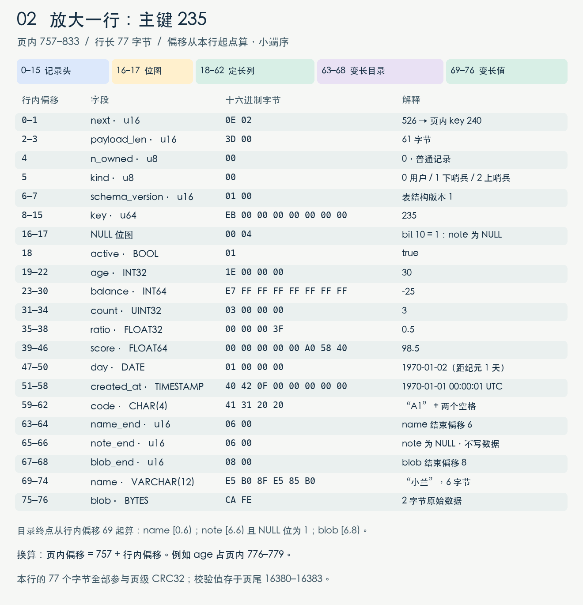

# Rebecca 存储引擎设计草案

**状态：待评审 · 2026-11-25。** 第一阶段要回答一个问题：给定一张 16 KiB 叶子页和对应的表结构，能否可靠地按主键读取、插入、删除和遍历记录，并把这一页完整写回、读回？下面的字节布局以已讨论的哨兵版示例为准。多页事务、崩溃恢复和表空间元数据格式仍是后续设计议题。

## 1. 一张页如何按主键组织

每行有一个唯一的 u64 主键。活行通过记录头的 next 按主键严格升序连成单向链；物理地址由空间分配决定。一端是下哨兵 infimum，另一端是上哨兵 supremum。两者按记录类型比较，比任何用户键都小或都大，不占用用户的数值范围，因此 0 和 u64 最大值都能当主键。

页目录是一个按组尾主键排序的稀疏数组。每个槽保存组尾的页内偏移，组尾记录的 n_owned 保存组内记录数。查一个键时先二分目录，再沿链查一组；按主键遍历全页时，直接从 infimum.next 走到 supremum。插入和删除通常只改链和分组计数。只有组数变化时，才需要为目录槽腾位置或补位。

## 2. 页的磁盘格式

整数和浮点字段都采用小端序。下文区间统一写为 **[起点, 终点)**，右端不包含；插图里的“起点～终点”则包含两端。所有页内指针都是相对页首的字节偏移，读写时不套用 Rust 结构体的内存对齐。

| 页内范围 | 类型 | 字段及约定 |
|---|---|---|
| [0,4) | 4 字节 | magic，ASCII `LPGE` |
| [4,6) | u16 | 页格式版本；本草案哨兵版为 2 |
| [6,8) | u16 | 页类型；1 为主键叶子页 |
| [8,16) | u64 | page_id；读回时与请求页号核对 |
| [16,18) | u16 | heap_top，可追加记录的首个偏移 |
| [18,20) | u16 | chain_head，指向偏移 32 的 infimum |
| [20,22) | u16 | record_count，只统计活用户行 |
| [22,24) | u16 | slot_count，包含两个边界槽 |
| [24,26) | u16 | garbage_bytes，记录堆内已回收、尚未并入连续空闲区的字节数 |
| [26,32) | 6 字节 | 保留，写零 |
| [32,48)、[48,64) | 各 16 字节 | infimum 和 supremum，各占一个无 payload 的记录头 |
| [64,heap_top) | 变长 | 用户记录及删除留下的洞 |
| [heap_top,dir_start) | 变长 | 可直接分配的连续空闲空间 |
| [dir_start,16380) | u16 数组 | 槽目录，按逻辑槽号从高地址向低地址排列 |
| [16380,16384) | u32 | CRC-32/IEEE，小端；只对前 16380 字节计算 |

逻辑槽 i 的地址是 `16380 - 2 × (i + 1)`，目录起点 `dir_start = 16380 - 2 × slot_count`。槽号与行偏移只在本页当前版本内使用；分组或整理都可能使原值失效。

**空页是一个可独立验证的状态。** heap_top=64，record_count=0，slot_count=2，garbage_bytes=0。slot 0 指向 32，slot 1 指向 48。infimum.next=48，supremum.next=0，两者 n_owned 都是 1。第一条用户行从 64 开始分配。

## 3. 一行如何编码

记录头长 16 字节。next 和 payload_len 各占 2 字节；n_owned 和 kind 各占 1 字节；schema_version 占 2 字节；最后 8 字节是主键。kind 的取值为 0 用户、1 下哨兵、2 上哨兵。哨兵的 payload_len、schema_version 和主键存储位写零，比较只看 kind。普通用户行只有作为组尾时 n_owned 才大于零。

用户行总长为 `16 + payload_len`。payload 分四段：

1. **NULL 位图。** 每个非主键列按 schema 顺序分配一位，共占 ceil(列数/8) 字节。第 0 列对应首字节最低位，1 表示 NULL。非空列的位必须为 0。
2. **定长值。** 按 schema 中定长列的相对顺序紧凑排列。BOOL 占 1 字节（0/1）；INT32、UINT32、FLOAT32、DATE 占 4 字节；INT64、UINT64、FLOAT64、TIMESTAMP 占 8 字节。浮点用 IEEE 754，DATE 表示距 1970-01-01 的天数，TIMESTAMP 表示 UTC Unix 微秒。CHAR(n) 固定占 n 个 UTF-8 字节容量，右补 ASCII 空格，读取时去掉尾随 ASCII 空格。定长 NULL 保留位置并写零。
3. **变长目录。** 每个变长列占一个 u16，值为该列在变长数据区内的累计结束偏移。第一列起点为零，后续列起点等于前一列的结束偏移。
4. **变长值。** VARCHAR(n) 存实际 UTF-8 字节，BYTES 存原始字节。CHAR 和 VARCHAR 的 n 均按字节计，超限报错。NULL 和空值都不写变长数据，靠位图区分。要求目录单调不减，最后一个结束偏移等于变长区长度。

schema_version 标识本行使用的表结构版本，与页格式版本独立。解码必须能取得对应版本的 schema。按数值比较主键，不能直接比较小端字节串。第一阶段一行必须可完整装入一张空页；先按宽整数计算长度、验证大小，再写入 u16 字段。

## 4. 查找、插入与删除

**查找。** 找到第一个组尾键大于或等于目标键的槽。若组尾用户键相等即可返回。否则从前一槽组尾的 next 向后比较，遇到相等返回该行，遇到更大的键或上哨兵返回未命中。两端哨兵保证空页、最小键、最大键共用这些边界。坏页和未命中须返回不同结果。

**插入。** 先查重并确定前驱、后继、所属组和本次所需空间。新行占 16 + payload_len 字节；若该组已有 8 条，还须为新槽预留 2 字节。空间确认后，在 heap_top 写新行，令新行.next 指向后继、前驱.next 指向新行，并更新计数。达到 9 条的组拆为 4 + 5；第 4 条成为新组尾，原组尾管理后 5 条。空页连续插入第 **8 条用户行**就首次拆组，因为尾组还含 supremum。主键重复或容量不足时，原页保持不变。

**物理删除。** 先找到行及前驱，跳过该行，更新组计数和活行数。删的是普通组尾时，先把组尾改到其前驱，再按剩余条数决定是否平衡。下哨兵始终只管自己；中间组维持 4～8 条；尾组可为 1～8 条，含上哨兵。

- 中间组从 4 降到 3，后一组多于 4 条：借后一组最小的那条，即当前组尾的 next。记录链顺序不变，移动组边界并修改组尾计数。
- 后一组至多 4 条：合并两组，由后一组组尾管理，移除当前槽，把后续槽收紧。目录释放的 2 字节直接变成连续空间。
- 尾组变小：保留 supremum 和最后一个槽。删除所有用户行后必须得到可用空页；草案建议直接恢复第 2 节的空页状态。

第一阶段是无 MVCC 的物理删除。后续有快照读时，逻辑删除、旧版本可见性和物理清理需要单独设计。

## 5. 碎片、整理与刷盘

若被删行结束地址等于 heap_top，回退 heap_top；否则将整行长度计入 garbage_bytes。第一阶段不逐个复用内部空洞。插入时按以下顺序检查：

| 判断 | 动作 |
|---|---|
| 连续空闲 ≥ 所需 | 直接插入 |
| 连续空闲不足，连续空闲 + garbage_bytes ≥ 所需 | 整理一次，再插入 |
| 二者之和仍不足 | 返回当前页空间不足；若放入空页也不可能，返回行过大 |

用临时 16 KiB 页整理：哨兵保持固定偏移，沿链复制活行，重建每个 next 和每个槽的组尾偏移，更新 heap_top、清空 garbage_bytes。整理前算出的前驱、后继偏移必须重新定位。完成并验证后替换原页。可用这个恒等式检查空间账：**heap_top − 64 = 活用户行总字节数 + garbage_bytes**。

在内存内修改成功后标记脏页。写回时对一致的 16 KiB 页快照计算 CRC，再整页写出；读取时先读满、验证 CRC，再信任长度和偏移。页结构校验还包括：堆与目录不重叠、行边界有效、链严格递增且终止于 supremum、活行数与页头一致、所有组尾位于链上、各组 n_owned 之和等于 record_count + 2。检查坏页时须限制遍历步数、防止环路，并在做减法或切片前先检查范围。

写回成功、同步文件成功和事务提交是三个不同的保证。CRC 能发现损坏，无法恢复撕裂页。并发刷脏的约束是同一页不能有乱序完成的多个写回；若快照写出后内存页已经更新，不得清除新修改的脏标记。锁、版本号和同步策略留到缓冲池设计阶段确定。

## 6. 用同一张页走通三个操作

示例页号 2，9 条活行，每行 77 字节；物理末尾的 key=235 位于偏移 757，heap_top=834。旧 key=220 留下 77 字节碎片。三个槽分别指向 infimum、key=180、supremum，管理条数为 **1、4、6**。这里 6 是 5 条用户行加上哨兵。页尾 CRC 为 `0x80153B96`。

- **查 235。** 二分槽定位到 (180, supremum]，沿 180 → 210 → 235 找到目标。行的 next 为 526，指向 240。
- **删 235。** 令 210.next 从 757 改为 526；supremum.n_owned 从 6 降到 5，活行数从 9 降到 8。235 位于物理末尾，heap_top 回退到 757；旧洞仍在，garbage_bytes 仍为 77，三个目录槽都不搬。
- **独立例子：删 180。** 从示例初始页出发，180 是中间组组尾。删除使该组剩 3 条，从尾组借 210；新组尾为 210，尾组仍以 supremum 结束。预期三个槽计数为 1、4、5，链上只缺 180。这里删除的行位于堆内部，碎片从 77 增至 154 字节。

## 7. 进入编码前的验收清单

| 场景 | 应观察到的结果 |
|---|---|
| 空页、插入主键 0 和 u64 最大值 | 哨兵不与用户键混淆；两键均可查到 |
| 从空页依次插入 7、8 条用户行 | 槽计数从 [1,8] 变为 [1,4,5]；全页扫描仍严格有序 |
| 乱序插入、重复键、查询不存在的键 | 物理追加不破坏逻辑顺序；拒绝重复键且页未变；未命中可区别于读错 |
| 删除普通记录、组尾、物理末尾、最后一行 | 覆盖借组、合组、回退 heap_top 和恢复空页 |
| 可容纳行但差 2 字节建新槽 | 整理或拒绝，不留下半条链或半个槽 |
| 内部空洞足够／不足以容纳新行 | 只在整理能解决问题时整理；旧行仍可按键查出 |
| CHAR 与 VARCHAR、NULL 与空串、负数及浮点 | 逐字节往返符合第 3 节，长度以 UTF-8 字节计 |
| 写出再读回；改动一个有效字节或页尾 CRC | 正常页可读取；遭改动的示例页被拒绝 |
| CRC 正确但目录越界、next 成环或行长越界 | 返回页结构错误，不能越界访问或死循环 |

## 8. 后续需要单独评审的决定

1. **表空间与 schema 持久化。** 已讨论 page 0 放文件头、page 1 放 schema、page 2 起放数据页。仍需定义元数据编码、旧 schema 保留方式和版本升级规则。
2. **多页索引。** 单页容量不足之后如何分裂、选分隔键、更新父页或根指针，以及叶子页之间如何扫描。
3. **事务与恢复。** 确定提交的持久化契约，再设计 WAL/redo、旧版本/undo、物理清理及坏页修复。当前示例不声称整页写具有掉电原子性。
4. **大值与行更新。** 定长或等长更新能否原地写、变长更新怎样保证失败不破坏原行、跨页大值何时引入。

分组槽、记录链与首尾哨兵的机制参考 [MySQL 8.4 页目录定义](https://github.com/mysql/mysql-server/blob/8.4/storage/innobase/include/page0page.h#L62-L86) 和[拆组、借组与合组实现](https://github.com/mysql/mysql-server/blob/8.4/storage/innobase/page/page0page.cc#L1191-L1310)。Rebecca 的行编码、偏移、页头和 CRC 页尾使用本文约定。
